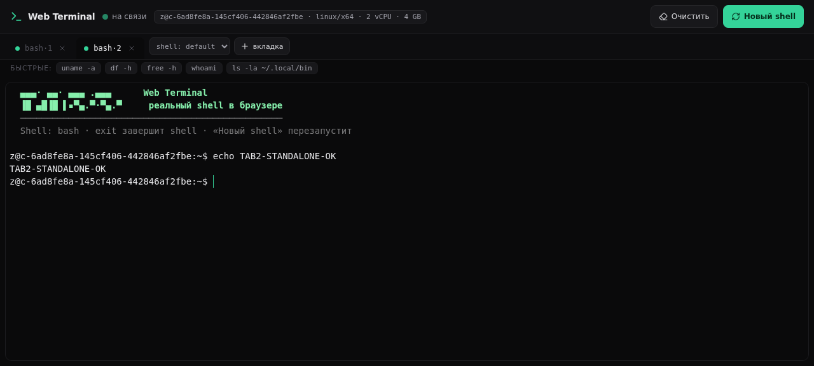

# Web Terminal

Браузерный терминал с **реальным PTY** — как sshx или ttyd, только self-hosted и на Node.js.
Открываете в браузере — получаете полноценный shell на своей машине: vim, htop, ssh, всё как в обычном терминале.

| | |
|---|---|
| **Фронт** | xterm.js (вендорен в репо, без CDN) |
| **Бэк** | Node.js + socket.io + node-pty (нативный PTY) |
| **Вкладки** | до 8 параллельных сессий, у каждой свой shell |
| **Авторизация** | пароль из `WEB_TERMINAL_PASSWORD` (constant-time сравнение) |
| **Выбор shell** | bash / zsh / fish / sh — всё, что есть в `/etc/shells` |
| **Ресайз** | живой, через ResizeObserver → `TIOCSWINSZ` |



---

## Установка

### Способ 1 — одной командой (как sshx)

```bash
curl -fsSL https://raw.githubusercontent.com/Jedafa/web-terminal/main/install.sh | bash
```

Скрипт:

1. проверит Node.js ≥ 18, git и npm;
2. склонирует репозиторий в `~/.web-terminal`;
3. соберёт `node-pty` (нужны `python3 make g++` — подскажет, если их нет);
4. положит лаунчер в `~/.local/bin/web-terminal`.

Повторный запуск скрипта = обновление до последней версии.

С systemd-сервисом (автозапуск при загрузке):

```bash
WEB_TERMINAL_PASSWORD=ваш_пароль ./install.sh --systemd
```

### Способ 2 — Docker

```bash
docker run -d --name web-terminal \
  -p 7681:7681 \
  -e WEB_TERMINAL_PASSWORD=ваш_пароль \
  --restart unless-stopped \
  ghcr.io/jedafa/web-terminal:main
```

Или через docker-compose:

```bash
WEB_TERMINAL_PASSWORD=ваш_пароль docker compose up -d
```

> ⚠️ Внутри контейнера терминал работает в файловой системе контейнера.
> Чтобы работать с файлами хоста, примонтируйте их: `-v /home/user/project:/data -e WEB_TERMINAL_DIR=/data`.

### Способ 3 — руками из исходников

```bash
git clone https://github.com/Jedafa/web-terminal.git
cd web-terminal
npm install        # соберёт node-pty (нужны python3, make, g++)
npm start          # → http://localhost:7681
```

---

## Запуск и настройка

```bash
web-terminal [опции]
```

| Опция | Переменная окружения | По умолчанию | Описание |
|---|---|---|---|
| `--port 7681` | `PORT` | `7681` | порт HTTP-сервера |
| `--host 0.0.0.0` | `HOST` | `0.0.0.0` | адрес привязки |
| `--password …` | `WEB_TERMINAL_PASSWORD` | *(нет)* | пароль (пусто = без авторизации) |
| `--shell /bin/zsh` | `WEB_TERMINAL_SHELL` | первый из `/etc/shells` | shell по умолчанию |
| `--dir ~/project` | `WEB_TERMINAL_DIR` | `~` | рабочая директория при старте |
| `--ttl 15` | — | `15` | сколько минут держать сессию после отключения клиента |

Примеры:

```bash
# пароль + порт + zsh + старт в проекте
WEB_TERMINAL_PASSWORD=секрет web-terminal --port 8080 --shell /bin/zsh --dir ~/my-project
```

После запуска откройте `http://<хост>:<порт>`. Если пароль задан — появится экран логина
(браузер запомнит пароль в `localStorage` и не спросит больше).

### Вкладки и shell

- **+ вкладка** — новая параллельная сессия (каждая вкладка = отдельный PTY-процесс);
- селект **shell:** — каким shell'ом открыть следующую вкладку (bash, zsh, fish — что установлено);
- **Новый shell** — перезапуск shell'а в активной вкладке (сессия и терминал сохраняются);
- **×** на вкладке — закрыть сессию и убить процесс;
- список вкладок живёт в `localStorage` — после F5 сессии переподключаются,
  а если перезагрузка была быстро, shell'ы даже не перезапускаются (reattach).

---

## Автозапуск (systemd)

`install.sh --systemd` создаёт user-юнит `~/.config/systemd/user/web-terminal.service`.
Вручную:

```ini
# ~/.config/systemd/user/web-terminal.service
[Unit]
Description=Web Terminal
After=network.target

[Service]
ExecStart=%h/.local/bin/web-terminal --port 7681
Environment=WEB_TERMINAL_PASSWORD=ваш_пароль
Restart=on-failure

[Install]
WantedBy=default.target
```

```bash
systemctl --user daemon-reload
systemctl --user enable --now web-terminal
loginctl enable-linger $USER   # чтобы сервис жил без активной сессии
```

---

## HTTPS за реверс-прокси (рекомендуется для VPS)

Терминалу нужен WebSocket — прокси должен проксировать апгрейд.

**Caddy** (самый простой, сертификаты сам):

```caddy
term.example.com {
    reverse_proxy localhost:7681
}
```

**nginx:**

```nginx
location / {
    proxy_pass http://127.0.0.1:7681;
    proxy_http_version 1.1;
    proxy_set_header Upgrade $http_upgrade;
    proxy_set_header Connection "upgrade";
    proxy_set_header Host $host;
    proxy_read_timeout 3600s;
    proxy_send_timeout 3600s;
}
```

---

## Нужен ли стабильный VPS для WebSocket?

**Нет, никаких особых требований нет.** WebSocket — это обычный HTTP-запрос,
который «дорастает» до постоянного соединения (HTTP Upgrade). Подойдёт любой
VPS/дедик/домашний сервер за NAT — главное, чтобы:

1. порт (или прокси) был доступен снаружи;
2. соединение не рвалось агрессивным файрволом/Cloudflare-таймаутом (по умолчанию у CF 100 c на простой трафик — но терминал постоянно шлёт данные, так что не рвётся);
3. при HTTPS прокси пробрасывал `Upgrade`-заголовки (конфиги выше).

Открытый порт без TLS = пароль и данные в открытом виде. Для публичного доступа
ставьте за Caddy/nginx с HTTPS.

## Безопасность

- **Всегда задавайте `WEB_TERMINAL_PASSWORD`**, если терминал доступен из интернета —
  это полноценный shell на вашей машине.
- Пароль сравнивается constant-time (защита от timing-атак); в логи не пишется.
- Пароль хранится в `localStorage` браузера и отправляется при каждом
  переподключении — используйте HTTPS, чтобы его не словили по пути.
- Хотите «одноразовую» ссылку-доступ? Придумайте длинный пароль и открывайте
  `https://term.example.com/#<пароль>`... нет, лучше просто введите его руками. 🙂

## Установка zsh / fish (по желанию)

```bash
# Debian/Ubuntu
sudo apt install -y zsh fish
# Fedora
sudo dnf install -y zsh fish
# Alpine
apk add zsh fish
```

После установки перезапустите сервер — shell'ы появятся в селекторе вкладок
(список берётся из `/etc/shells`).

## Как это работает

```
браузер (xterm.js) ⇄ WebSocket (socket.io) ⇄ server.mjs ⇄ node-pty ⇄ bash/zsh/fish
```

- каждая вкладка = отдельный socket + отдельный PTY-процесс;
- ввод с клавиатуры уходит в PTY, вывод PTY — в xterm (по комнатым сессий);
- resize окна браузера → `fit()` → `pty.resize()` → `SIGWINCH` в приложениях;
- сессия держится `--ttl` минут после отключения последнего клиента (reattach),
  вкладка закрыта кнопкой → процесс убит мгновенно;
- фронтенд — статика из `public/`, без сборки и без CDN: xterm и socket.io-клиент
  вендорены в `public/vendor/`.

## Структура проекта

```
web-terminal/
├── server.mjs          # HTTP + socket.io + node-pty + auth + сессии
├── bin/web-terminal.js # CLI-лаунчер (npm bin)
├── public/
│   ├── index.html      # UI: вкладки, логин, статус
│   ├── app.js          # вся логика фронта (vanilla JS)
│   ├── style.css
│   └── vendor/         # xterm.js, addon-fit, socket.io-client (MIT-лицензии)
├── install.sh          # установщик в ~/.web-terminal + лаунчер
├── Dockerfile
├── docker-compose.yml
└── LICENSE             # MIT
```

## Требования

- Node.js ≥ 18
- `python3`, `make`, `g++` (для сборки node-pty; в Docker-образе уже есть)
- Linux / macOS (Windows — через WSL)

## FAQ

**Чем это лучше sshx?**
Это ваше, self-hosted: данные не уходят на чужой сервер, можно править код как хочется.
sshx шарит терминал по ссылке, этот проект — личный терминал с авторизацией.

**Несколько человек одновременно?**
Да, каждая вкладка/браузер получает свою сессию. Смотреть одну сессию вдвоём
(как в sshx) пока нельзя — но сессии разделяются по ID, так что совместный режим
легко добавить.

**Пароль забыт?**
Перезапустите сервис с новой переменной `WEB_TERMINAL_PASSWORD`.

**Как обновить?**
`curl -fsSL https://raw.githubusercontent.com/Jedafa/web-terminal/main/install.sh | bash`
— скрипт обновит существующую установку.
